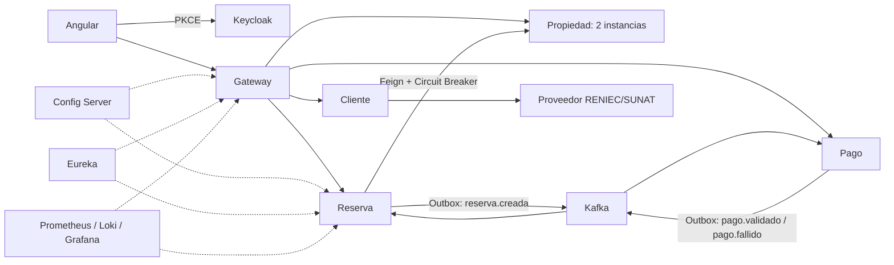

# Arquitectura y contratos

Cada servicio tiene su propia base lógica PostgreSQL, sin claves foráneas entre servicios. En local se comparte el servidor PostgreSQL para reducir consumo. Los datos pertenecen al servicio que los administra.

| Servicio | Endpoints | Regla |
|---|---|---|
| Propiedad | GET `/api/v1/propiedades`, `/{id}` | Lectura pública |
| TipoPropiedad | `/api/v1/tipos-propiedad` | GET público; POST/PUT/DELETE administrador |
| Propiedad | POST/PUT/DELETE `/api/v1/propiedades` | ADMIN |
| Reserva | POST/GET `/api/v1/reservas`, GET `/{id}` | JWT y dueño por `sub` |
| Pago | GET `/api/v1/pagos/{id}`, `/por-reserva/{id}` | JWT y dueño |
| Pago | GET `/api/v1/pagos` | ADMIN |
| Cliente | GET/PUT/DELETE `/api/v1/clientes/me` | Dueño derivado del JWT |
| Cliente | GET `/api/v1/clientes` | ADMIN |
| Documento | GET `/api/v1/documentos/DNI/{numero}` o `/RUC/{numero}` | JWT; proveedor con token |

Las mutaciones internas de disponibilidad están negadas por Gateway. El servicio de propiedades exige además `X-Internal-Secret`. Feign lo añade desde configuración; no se usa en el navegador. Los servicios de datos validan JWT y permisos también en accesos directos.

Una reserva contiene exactamente una propiedad y cantidad 1. Los precios vienen de propiedad, nunca del navegador. El cliente no puede elegir el dueño por JSON. Si propiedad no responde, Circuit Breaker produce un registro CARRITO sin pago: se comunica al usuario que no se confirmó la reserva.

Los eventos de pago se deduplican por la restricción única de `reserva_id`. Las transiciones de reserva usan bloqueo y revisan el estado: un duplicado posterior no repite la compensación. Los outbox proporcionan envío al menos una vez, por lo que los consumidores deben ser idempotentes. Una restauración fallida mantiene la reserva pendiente y permite reintento, sin ocultar el error.

`X-Trace-ID` se conserva en Gateway y Feign y aparece en Loki. Las operaciones asíncronas se correlacionan además por `reservaId`. Un reinicio de Keycloak o Kafka no se confunde con una prueba superada: revisar resultados en `evidencias`.
