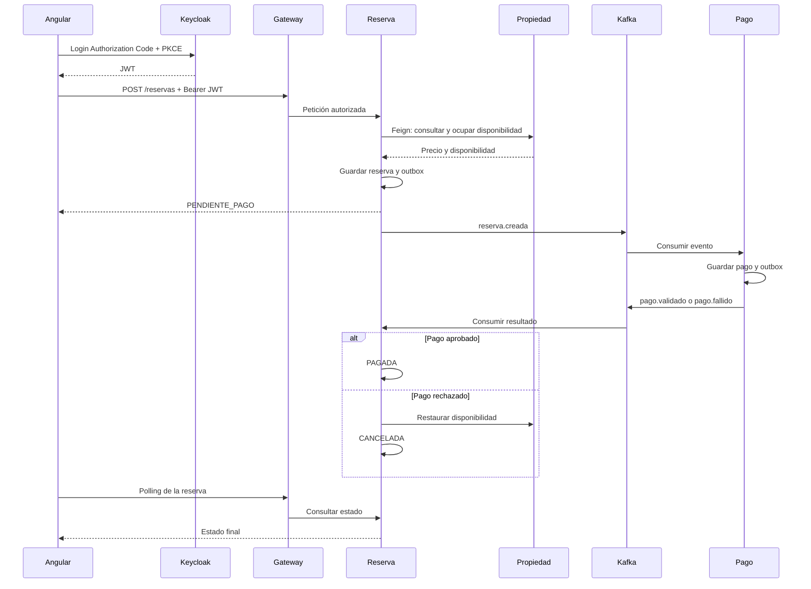

# Guía para entender y sustentar CASA O NADA

Empieza por el recorrido de una reserva. Después estudia las clases que participan en ese recorrido. No necesitas memorizar todo el repositorio de una vez.

## 1. Qué construimos

CASA O NADA es un prototipo académico de reservas inmobiliarias. Permite publicar propiedades, registrar el perfil de un cliente, separar una propiedad y observar si el pago simulado se aprueba o rechaza.

El importe mostrado es el de la **reserva o separación**, no el precio de venta de la vivienda. Cada propiedad tiene un cupo: `stock = 1` significa disponible y `stock = 0` significa ocupada. Se conserva la palabra `stock` del ejemplo del docente, pero aquí representa disponibilidad.

El sistema se divide en aplicaciones independientes. Cada una tiene su propio `pom.xml`, configuración, proceso Java y responsabilidad. Docker las ejecuta juntas; no las convierte en una sola aplicación.

## 2. Mapa del repositorio

| Carpeta | Responsabilidad | Qué debes poder explicar |
|---|---|---|
| [`services/casa-propiedad-ms`](../services/casa-propiedad-ms) | Propiedades y tipos | CRUD, validación, disponibilidad y bloqueo concurrente |
| [`services/casa-reserva-ms`](../services/casa-reserva-ms) | Reservas | Identidad del dueño, consulta Feign, estados y compensación |
| [`services/casa-pago-ms`](../services/casa-pago-ms) | Pago simulado | Consumo de eventos, aprobación, rechazo y duplicados |
| [`services/casa-cliente-ms`](../services/casa-cliente-ms) | Perfil del cliente | Datos personales vinculados al JWT y consulta DNI/RUC |
| [`services/casa-auth-ms`](../services/casa-auth-ms) | Práctica S07 de autenticación propia | Contraseñas cifradas, JWT RSA y JWKS; se sustituye por Keycloak |
| [`infra/casa-config`](../infra/casa-config) | Configuración centralizada | Diferencias entre `dev` y `prod` |
| [`infra/casa-eureka`](../infra/casa-eureka) | Registro de servicios | Cómo se descubren las instancias |
| [`infra/casa-gateway`](../infra/casa-gateway) | Entrada de las API | Rutas, roles y balanceo |
| [`keycloak`](../keycloak) | Identidad final del sistema | Realm, usuarios, roles y login PKCE |
| [`clients/casa-frontend`](../clients/casa-frontend) | Interfaz Angular | Componentes, formularios, servicios HTTP y estado reactivo |
| [`obs`](../obs) | Observabilidad | Métricas, logs, paneles y alertas |
| [`scripts`](../scripts) | Arranque y verificación | Cómo repetir las pruebas y qué comprueba cada una |

[`compose.json`](../compose.json) conecta todos los componentes. Es el archivo principal para ejecutar esta entrega. Los compose por carpeta se conservan como referencia de las prácticas del docente.

## 3. Las capas de un microservicio

Usa propiedad como ejemplo. Sus clases están en [`pe/edu/upeu/propiedad`](../services/casa-propiedad-ms/src/main/java/pe/edu/upeu/propiedad).

```text
Petición HTTP
    ↓
Controller → Service → Repository → PostgreSQL
                 ↕
             Entity / DTO / Mapper
```

| Pieza | Función | Ejemplo |
|---|---|---|
| Controller | Recibe la URL, el método HTTP y los datos | `PropiedadController` recibe `POST /api/v1/propiedades` |
| DTO Request | Describe y valida la entrada | `PropiedadRequest` exige nombre, dirección, área y tipo |
| Service | Aplica las reglas de negocio | `PropiedadService.descontarStock()` exige cantidad 1 y disponibilidad |
| Repository | Consulta y persiste datos mediante JPA | `PropiedadRepository.bloquear()` bloquea la fila durante la transacción |
| Entity | Representa una tabla | `Propiedad` se relaciona con `TipoPropiedad` |
| Mapper | Convierte entre entidad y DTO | MapStruct implementa `PropiedadMapper` al compilar |
| DTO Response | Define lo que se devuelve al cliente | `PropiedadResponse` expone nombre, ciudad, precio y tipo |
| Exception Handler | Traduce errores a respuestas HTTP | No encontrado → 404; falta de disponibilidad → 409 |

Anotaciones importantes:

- `@RestController`: expone métodos como API HTTP.
- `@Service`: registra una clase de lógica de negocio.
- `@Entity`: declara una entidad persistente de JPA.
- `@Valid`: activa las validaciones del DTO recibido.
- `@Transactional`: agrupa operaciones en una transacción de la base **de ese servicio**.
- `@RequiredArgsConstructor`: Lombok genera el constructor para inyectar los campos `final`.
- `@Getter`, `@Setter`, `@Builder`: Lombok genera código repetitivo; no implementa las reglas del negocio.

Ejemplo: cambiar el texto de un botón se hace en Angular; cambiar quién puede reservar se hace en seguridad o en el servicio de reservas; cambiar una columna requiere entidad y migración SQL, y posiblemente DTO y pantalla.

## 4. Sigue una reserva completa



Lee los archivos en este orden:

1. [`ReservaController.java`](../services/casa-reserva-ms/src/main/java/pe/edu/upeu/reserva/controller/ReservaController.java): observa que obtiene el dueño con `jwt.getSubject()`. El navegador no decide el cliente mediante el JSON.
2. [`ReservaRequest.java`](../services/casa-reserva-ms/src/main/java/pe/edu/upeu/reserva/dto/ReservaRequest.java): exige exactamente un detalle. La cantidad también está limitada a 1 en `DetalleReservaRequest`.
3. [`ReservaServiceImpl.java`](../services/casa-reserva-ms/src/main/java/pe/edu/upeu/reserva/service/ReservaServiceImpl.java): lee primero `crear()`, luego `marcarPagada()` y finalmente `compensar()`.
4. [`PropiedadConsultaService.java`](../services/casa-reserva-ms/src/main/java/pe/edu/upeu/reserva/service/PropiedadConsultaService.java): contiene las llamadas protegidas por Circuit Breaker y sus fallbacks.
5. [`PropiedadClient.java`](../services/casa-reserva-ms/src/main/java/pe/edu/upeu/reserva/client/PropiedadClient.java): declara las llamadas HTTP de Feign.
6. [`PropiedadService.java`](../services/casa-propiedad-ms/src/main/java/pe/edu/upeu/propiedad/service/PropiedadService.java): busca el bloqueo y la regla que impide ocupar el mismo cupo dos veces.
7. [`ReservaEventosProducer.java`](../services/casa-reserva-ms/src/main/java/pe/edu/upeu/reserva/messaging/ReservaEventosProducer.java): guarda el evento pendiente y lo envía a Kafka.
8. [`PagoServiceImpl.java`](../services/casa-pago-ms/src/main/java/pe/edu/upeu/pago/service/PagoServiceImpl.java): evita pagos duplicados y decide el resultado simulado.
9. [`PagoEventosConsumer.java`](../services/casa-reserva-ms/src/main/java/pe/edu/upeu/reserva/messaging/PagoEventosConsumer.java): dirige el resultado a `marcarPagada()` o `compensar()`.

El precio viene del servicio de propiedades. Si el cliente modifica el total en su navegador, el backend no lo usa para calcular la reserva.

## 5. Los estados y la consistencia eventual

| Estado de reserva | Significado real en este código |
|---|---|
| `CARRITO` | La validación o la ocupación del cupo no se completó. Puede deberse a falta de disponibilidad o a un servicio inaccesible. No se publica el evento de pago. |
| `PENDIENTE_PAGO` | La propiedad fue ocupada y se registró la reserva; falta el resultado asíncrono del pago. |
| `PAGADA` | Se recibió y aplicó `pago.validado`. |
| `CANCELADA` | Se recibió `pago.fallido` y se ejecutó la compensación. |

La reserva no pasa a pagada en la misma respuesta que la crea. Angular consulta las reservas pendientes cada cuatro segundos en [`mis-pedidos.ts`](../clients/casa-frontend/src/app/features/reservas/mis-pedidos.ts). Eso permite mostrar el estado eventual sin recargar la página.

**SAGA** significa aquí coordinar pasos locales y una compensación. Si el pago se rechaza, reserva intenta devolver la disponibilidad. No se revierte toda la aplicación mediante un único `ROLLBACK`.

**Outbox** es la tabla `eventos_pendientes`, presente tanto en reserva como en pago. El dato de negocio y su evento se guardan en la misma transacción local. Un proceso programado intenta enviarlo cada dos segundos. Tras la confirmación de Kafka, elimina el pendiente.

Aunque el método conserve el nombre `publicarTrasCommit()`, en esta versión **guarda el outbox**; el envío lo hace `despachar()`. No confundas el nombre heredado con su implementación actual.

Si se envía un evento y el proceso se interrumpe antes de eliminarlo del outbox, puede enviarse otra vez. Por eso el envío es **al menos una vez**, no exactamente una vez. Pago verifica la reserva y tiene una restricción única sobre `reserva_id`; reserva controla su estado antes de cambiarlo o compensarlo.

## 6. Seguridad: cuatro ideas que no debes confundir

1. **Autenticación:** Keycloak comprueba quién eres y emite un JWT firmado.
2. **Validación del token:** Gateway y servicios validan firma, emisor y vigencia; decodificar el texto del JWT en Angular no demuestra que sea válido.
3. **Autorización por rol:** un `CLIENTE` no puede administrar propiedades; el administrador tiene `ADMIN`.
4. **Autorización por dueño:** estar autenticado no permite leer reservas o pagos de otro usuario. El servicio compara el dueño con el `sub` del JWT. Un objeto ajeno responde 404.

Los botones ocultos en Angular mejoran la experiencia, pero no son la barrera de seguridad. La protección debe mantenerse aunque alguien llame a la API directamente.

Las rutas internas para descontar y restaurar disponibilidad están bloqueadas en Gateway. Propiedad comprueba además `X-Internal-Secret`, que añade Feign desde el servidor. Ese secreto no va al navegador.

Para estudiar PKCE, lee [`auth-service.ts`](../clients/casa-frontend/src/app/core/auth/auth-service.ts) y [`pkce.ts`](../clients/casa-frontend/src/app/core/auth/pkce.ts). El verificador temporal se conserva en la pestaña y su hash se envía al iniciar el login. El parámetro `state` se comprueba al regresar.

`casa-auth-ms` corresponde a S07: usuarios y roles propios, contraseñas cifradas y JWT RSA. Desde S07b, el login final usa Keycloak. No son dos logins que el usuario necesite completar.

## 7. Configuración, descubrimiento y observabilidad

**Config Server:** [`config-repo`](../infra/casa-config/config-repo) contiene archivos por aplicación y ambiente. `dev` permite más detalle de diagnóstico; `prod` reduce esos detalles. Las variables del compose ajustan conexiones y puertos dentro de Docker.

**Eureka:** registra instancias. Feign y Gateway pueden referirse al nombre del servicio en vez de fijar una única dirección. En el compose hay `propiedad` y `propiedad2`, ambas sobre la misma base lógica de propiedades. No son dos catálogos separados.

**Gateway:** recibe las solicitudes del cliente en el puerto 18080, valida reglas de acceso y enruta. El balanceo reparte las solicitudes entre las instancias registradas de propiedad.

**Prometheus:** recoge métricas numéricas, por ejemplo disponibilidad y cantidad de solicitudes. **Loki:** recibe logs. **Grafana:** muestra ambos mediante paneles. Un servicio puede producir logs aunque el recolector esté fallando: son pasos distintos de la cadena.

`X-Trace-ID` permite buscar una misma solicitud en varios servicios. Feign propaga la cabecera. Los eventos asíncronos se relacionan además por `reservaId`; no asumas que toda comunicación Kafka tiene automáticamente el mismo contexto HTTP.

## 8. Cómo está organizado Angular

| Archivo o carpeta | Qué estudiar |
|---|---|
| [`app.routes.ts`](../clients/casa-frontend/src/app/app.routes.ts) | URL → componente y guards |
| [`core/layout`](../clients/casa-frontend/src/app/core/layout) | Cabecera, menú y espacio de las pantallas |
| [`core/interceptors`](../clients/casa-frontend/src/app/core/interceptors) | Añadir JWT y trace a las solicitudes HTTP |
| [`features/propiedad/propiedades.ts`](../clients/casa-frontend/src/app/features/propiedad/propiedades.ts) | Catálogo, búsqueda y formulario del administrador |
| [`features/reservas/reserva-crear.ts`](../clients/casa-frontend/src/app/features/reservas/reserva-crear.ts) | Selección de una propiedad y envío de la reserva |
| [`features/reservas/mis-pedidos.ts`](../clients/casa-frontend/src/app/features/reservas/mis-pedidos.ts) | Lista propia, estados y polling |
| [`features/clientes/perfil.ts`](../clients/casa-frontend/src/app/features/clientes/perfil.ts) | Perfil y consulta opcional del documento |
| [`features/propiedad/foto-propiedad.ts`](../clients/casa-frontend/src/app/features/propiedad/foto-propiedad.ts) | Fotografía ilustrativa según tipo de propiedad |

`signal()` guarda un valor reactivo. Se lee con `valor()` y se modifica con `.set()` o `.update()`. Un `computed()` calcula un resultado a partir de otros valores reactivos. Los callbacks HTTP deben notificar los cambios que la pantalla necesita mostrar.

Los métodos del servicio Angular realizan peticiones HTTP. Los métodos del servicio Java aplican reglas del negocio: aunque ambos se llamen “Service”, se ejecutan en lugares distintos.

Las fotos están en `public/images` y se sirven como archivos locales. Son fotografías reales de referencia por categoría, no fotos verificadas de las direcciones de los datos de ejemplo. Sus fuentes están en [`CREDITOS_FOTOS.md`](CREDITOS_FOTOS.md).

## 9. Bases de datos y migraciones

Cada servicio tiene una base lógica propia en PostgreSQL. Para reducir recursos locales, el compose utiliza un único servidor PostgreSQL con varias bases. Eso no introduce relaciones JPA ni claves foráneas entre servicios.

Flyway ejecuta las migraciones de `src/main/resources/db/migration` en orden. Ejemplos:

- Propiedad: tablas, semillas, datos inmobiliarios y normalización de la columna del tipo.
- Reserva: tablas de reserva/detalle, identificador de cliente y outbox.
- Pago: tabla de pagos, dueño y outbox.
- Cliente: perfil vinculado a `usuario_id`.

Para ampliar un esquema que ya se ejecutó, crea una migración nueva. Editar una migración aplicada cambia su checksum y puede impedir el arranque. La corrección de columna de este proyecto se resolvió con una migración que conserva datos.

## 10. Qué practicar con el sistema encendido

Desde la raíz del proyecto:

```powershell
# Compilar Java y ejecutar sus pruebas
mvn clean package

# Arranque integrado: prod local por defecto
.\scripts\iniciar.ps1

# Variante para prácticas con Swagger
.\scripts\iniciar.ps1 -Perfil dev

# Verificar API, permisos, concurrencia y flujo de pago
python scripts/verificar.py

# Balanceo, configuración y métricas
python scripts/verificar_infra.py
```

Para probar caídas, usa `python scripts/verificar_fallos.py` cuando nadie esté haciendo una demostración: detiene temporalmente Kafka o propiedad y los restaura. Lee el script antes de ejecutarlo para poder explicar el resultado.

Frontend, desde su carpeta y con una versión compatible de Node:

```powershell
npm ci
npm test
npm run build
```

Las cuentas `cliente1`, `cliente2` y `admin` usan `Casa2026!` en esta demostración local. El pago rechazado se simula con `TARJETA_RECHAZADA`. DNI/RUC necesita `DOCUMENTOS_TOKEN`; sin esa credencial, el perfil se registra manualmente y la consulta externa no está disponible.

Los resultados históricos de esta entrega están en [`evidencias`](../evidencias). Una prueba aprobada ayer no garantiza que tus cambios de hoy funcionen: repite las pruebas relacionadas con lo que modificaste.

## 11. Plan de estudio en cuatro bloques

| Bloque | Qué leer y hacer | Cómo comprobar que lo entendiste |
|---|---|---|
| 1. CRUD y persistencia | PropiedadController → PropiedadService → PropiedadRepository → entidad y SQL. Crea y actualiza una propiedad. | Explica dónde se valida el área y dónde se guarda. |
| 2. Reservas y seguridad | ReservaController, DTO, `crear()`, Feign, guards y JWT. Prueba con cliente1 y cliente2. | Explica por qué no puedes enviar el dueño en el request ni leer una reserva ajena. |
| 3. Mensajería y fallos | Outbox, consumidores, PagoService y `compensar()`. Ejecuta aprobación y rechazo. | Dibuja los eventos y explica qué ocurre si Kafka cae o repite un mensaje. |
| 4. Integración y defensa | Config, Eureka, Gateway, Angular y Grafana. Repite el flujo completo. | Muestra dos instancias, localiza una traza y explica el recorrido sin leer el README. |

Para cada bloque, abre una clase de la otra parte del equipo y explícasela a tu compañero. La propuesta de responsabilidades futuras está en [`REPARTO_Y_DEFENSA.md`](REPARTO_Y_DEFENSA.md); ambos necesitan entender el recorrido completo.

## 12. Preguntas de práctica y respuesta breve

**¿Por qué usar DTO si ya existe la entidad?** Para definir el contrato de entrada/salida y no exponer automáticamente todos los campos persistidos.

**¿Por qué una reserva tiene el ID de la propiedad en vez de una relación JPA con ella?** Porque la entidad propiedad pertenece a otro servicio y otra base. La integración se realiza mediante API y eventos.

**¿Qué protege el bloqueo de la fila?** La comprobación y modificación de la disponibilidad dentro de la transacción local de propiedad.

**¿Feign y Kafka hacen lo mismo?** Feign espera una respuesta HTTP inmediata; Kafka comunica eventos que se procesan de forma asíncrona.

**¿El Circuit Breaker inventa una respuesta válida cuando el servicio cae?** No. El fallback deja la reserva sin confirmar ni iniciar pago, y evita asumir que existe disponibilidad.

**¿Qué resuelve el outbox?** La separación entre confirmar los datos locales y enviar su evento; permite reintentar un envío pendiente.

**¿El outbox convierte todo el sistema en una transacción única?** No. No convierte la llamada HTTP de disponibilidad y la escritura de reserva en una operación atómica entre dos bases.

**¿Por qué sigue siendo necesaria la idempotencia?** Porque un evento puede entregarse más de una vez, incluso usando outbox.

**¿Por qué ocultar un botón no basta?** Porque alguien puede llamar a la API sin usar la interfaz.

**¿Qué revisas ante un 401, un 403 y un 404?** 401: falta de autenticación válida. 403: permiso insuficiente o ruta interna prohibida. 404: recurso inexistente o ajeno según la regla del servicio.

## 13. Mejoras que podemos hacer después

El prototipo no es un sistema de compraventa listo para operar con dinero real. El pago es simulado; las fotos son ilustrativas y la consulta externa necesita credencial. El alcance y las pruebas ejecutadas están en [`ESTADO_VERIFICADO.md`](../ESTADO_VERIFICADO.md).

Mejoras técnicas concretas para estudiar: fotos propias por inmueble, filtros más completos, recuperación explícita de reservas `CARRITO`, renovación de sesión y coordinación más robusta de la ocupación de disponibilidad. Existe una ventana entre ocupar una propiedad por HTTP y confirmar la base de reservas; el outbox de reserva no elimina por sí solo esa ventana. Conviene explicar esta limitación antes de afirmar garantías de producción que el código no ofrece.

## 14. Cómo continuar desde GitHub

El repositorio es [Stephmarc/CASA-O-NADA](https://github.com/Stephmarc/CASA-O-NADA). Esta entrega inicial se subió completa; no se repartió artificialmente su historial entre integrantes.

Para los próximos cambios, cada uno trabaja con su cuenta y una rama propia:

```powershell
git clone https://github.com/Stephmarc/CASA-O-NADA.git
cd CASA-O-NADA
git switch -c feature/mi-mejora

# Realizar una mejora, revisarla y probarla
git add ruta/del/archivo
git commit -m "Describir la mejora realizada"
git push -u origin feature/mi-mejora
```

Después abren un pull request, el compañero lo revisa y lo integran en `main`. No trabajen editando el ZIP: el repositorio clonado debe ser su carpeta de trabajo para los siguientes avances.
